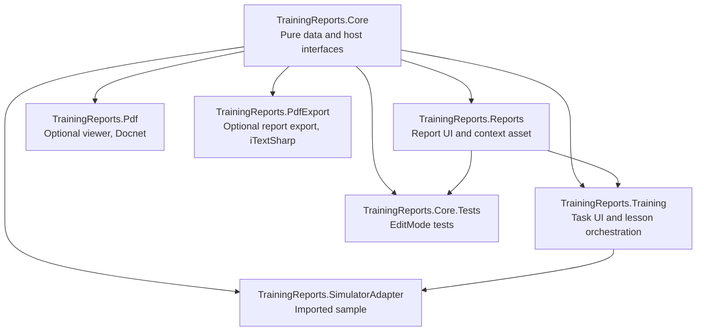

# Training Reports for Unity

Training task UI, score calculation, and configurable lesson performance reports for Unity 6 projects. Simulator-specific behavior is supplied by the host through package interfaces; this package contains no simulator SDK or vehicle controller dependency.

## Installation

In Unity, open **Window > Package Manager > + > Add package from git URL...** and use one of these URLs:

- Stable branch: `https://github.com/schaeffergui/unity-training-reports.git#main`
- Development branch: `https://github.com/schaeffergui/unity-training-reports.git#dev`

You can also add the package to `Packages/manifest.json`:

```json
{
  "dependencies": {
    "com.schaeffergui.training-reports": "https://github.com/schaeffergui/unity-training-reports.git#main"
  }
}
```

## Requirements and optional libraries

- Unity 6 (`6000.0` or newer).
- `com.unity.ugui`, declared as a package dependency. The UI scripts also use Unity's TextMeshPro assembly.
- No simulator SDK, Rewired, or Vehicle Physics Pro dependency is required by the package assemblies.
- The in-game PDF viewer is optional. Add `Docnet.Core.dll` and the native PDFium library (`pdfium.dll` on Windows) to the host project and define `TRAINING_REPORTS_PDF` to compile `TrainingReports.Pdf`. Native and managed libraries are not included in this package.
- PDF export is optional. Add the iTextSharp 5.x assembly as `itextsharp.dll` and define `TRAINING_REPORTS_PDF_EXPORT` to compile `TrainingReports.PdfExport`. iTextSharp is not included in this package; review its LGPL/AGPL licensing terms before distributing it.

The PDF viewer and exporter are disabled when their scripting symbols are absent, so projects can use the Core, Reports, and Training assemblies without those optional libraries.

## PDF viewer

Call `LessonPdfViewer.Open(localPdfPath)` to show a local report. If a `Resources/UI/LessonPdfViewer` prefab is present, the viewer uses it as an optional visual override; otherwise it builds a uGUI panel, page display, navigation controls, zoom controls, page counter, and status labels at runtime. The fallback uses Unity's built-in `LegacyRuntime.ttf` font and does not need a prefab or TextMeshPro assets. Install the native PDFium library for each target platform alongside `Docnet.Core.dll`; this package does not ship either library.

## Package architecture



## Connect a host project

`TrainingManager` accepts a host component implementing `ITrainingContext`, `ITrainingOperationRunner`, and the relevant vehicle, theme, metrics, and report interfaces. The runner receives an `ITrainingTaskSink` and `IVehicleProbe`; it owns the host's operation-specific checks and reports task results through the sink. `TrainingTaskUI` renders those results with the supplied `ITrainingTheme`.

Import **Samples > Training Reports > Simulator Adapter** in Package Manager for a plain C# example. It demonstrates the interface wiring with sample data; replace its illustrative lesson checks and report presenter with the host's real operation logic and reporting integration.

## Tests

The package includes EditMode tests for report inputs, observation thresholds, telemetry statistics, and score calculation. The latest Unity 6 consumer-project run completed **25/25 EditMode tests**.

## Verification status

- Unity `6000.2.1f1` compiled the consumer with `TRAINING_REPORTS_PDF` and `TRAINING_REPORTS_PDF_EXPORT` enabled; the Console reported no compile errors. The consumer imported Docnet, iTextSharp, BouncyCastle, and the user-supplied Windows x86_64 `pdfium.dll`.
- All **25/25 EditMode tests passed** with both optional symbols enabled.
- The exporter produced a four-page sample PDF in the consumer project's ignored `Temp/TrainingReportsValidation` folder.
- In Play Mode, the viewer opened the sample, Docnet reported 4 pages, and invoking Next advanced the counter to Page 2 of 4. At a 2× display scale, the viewer rendered page 2 to **1746x2472** while preserving the PDF page's portrait aspect ratio. Rendering is capped at 2880 pixels on the long edge and 8 million pixels per page.
- A fresh **3840x2160** Play Mode capture showed the fallback viewer panel, PDF page, previous/next and zoom controls, close/back/save controls, and the Page 2 of 4 counter. The fallback UI has rounded surfaces generated at runtime; a `Resources/UI/LessonPdfViewer` prefab can still provide a visual override.
- The three third-party DLLs and the Scripting Define Symbols are local to the separate consumer project and are not part of this package repository. No simulator behavior has been exercised, and no `MinimalLesson` scene is included.
