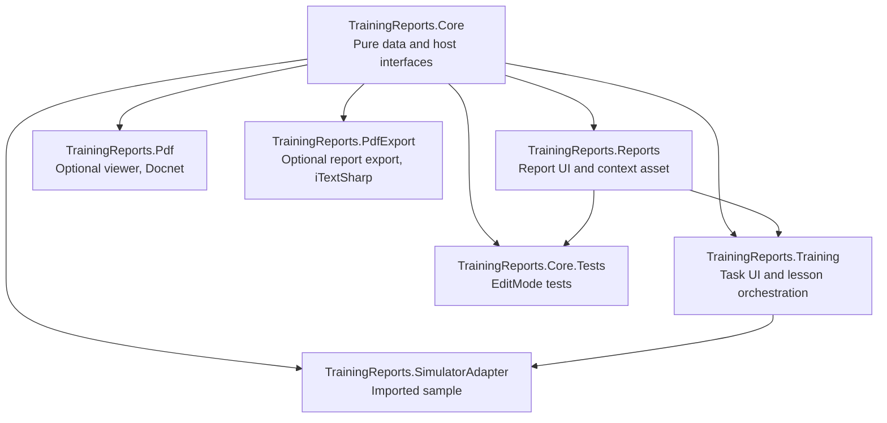

# Training Reports for Unity

Training task UI, score calculation, and configurable lesson performance reports for Unity 6 projects. Simulator-specific behavior is supplied by the host through package interfaces; this package contains no simulator SDK or vehicle controller dependency.

## Installation

In Unity, open **Window > Package Manager > + > Add package from git URL...** and use one of these URLs:

- Stable branch: `https://github.com/schaeffergui/unity-training-reports.git#main`
- Development branch: `https://github.com/schaeffergui/unity-training-reports.git#dev`

You can also add the package to `Packages/manifest.json`:

```json
{
  "dependencies": {
    "com.schaeffergui.training-reports": "https://github.com/schaeffergui/unity-training-reports.git#main"
  }
}
```

## Requirements and optional libraries

- Unity 6 (`6000.0` or newer).
- `com.unity.ugui`, declared as a package dependency. The UI scripts also use Unity's TextMeshPro assembly.
- No simulator SDK, Rewired, or Vehicle Physics Pro dependency is required by the package assemblies.
- The in-game PDF viewer is optional. Add `Docnet.Core.dll` to the host project and define `TRAINING_REPORTS_PDF` to compile `TrainingReports.Pdf`.
- PDF export is optional. Add the iTextSharp 5.x assembly as `itextsharp.dll` and define `TRAINING_REPORTS_PDF_EXPORT` to compile `TrainingReports.PdfExport`. iTextSharp is not included in this package; review its LGPL/AGPL licensing terms before distributing it.

The PDF viewer and exporter are disabled when their scripting symbols are absent, so projects can use the Core, Reports, and Training assemblies without those optional libraries.

## Package architecture



## Connect a host project

`TrainingManager` accepts a host component implementing `ITrainingContext`, `ITrainingOperationRunner`, and the relevant vehicle, theme, metrics, and report interfaces. The runner receives an `ITrainingTaskSink` and `IVehicleProbe`; it owns the host's operation-specific checks and reports task results through the sink. `TrainingTaskUI` renders those results with the supplied `ITrainingTheme`.

Import **Samples > Training Reports > Simulator Adapter** in Package Manager for a plain C# example. It demonstrates the interface wiring with sample data; replace its illustrative lesson checks and report presenter with the host's real operation logic and reporting integration.

## Tests

The package includes EditMode tests for report inputs, observation thresholds, telemetry statistics, and score calculation. The latest Unity 6 consumer-project run completed **25/25 EditMode tests**.

## Verification status

- Core, Reports, and Training compiled in Unity `6000.2.1f1` with optional PDF scripting symbols off.
- The sample adapter assembly compiled when imported into the consumer project. It has not been exercised in a real simulator.
- The PDF viewer has not been compiled with `Docnet.Core.dll` in the consumer project.
- The PDF exporter has not been compiled with iTextSharp and `TRAINING_REPORTS_PDF_EXPORT` enabled.
- No `MinimalLesson` scene is included yet.
